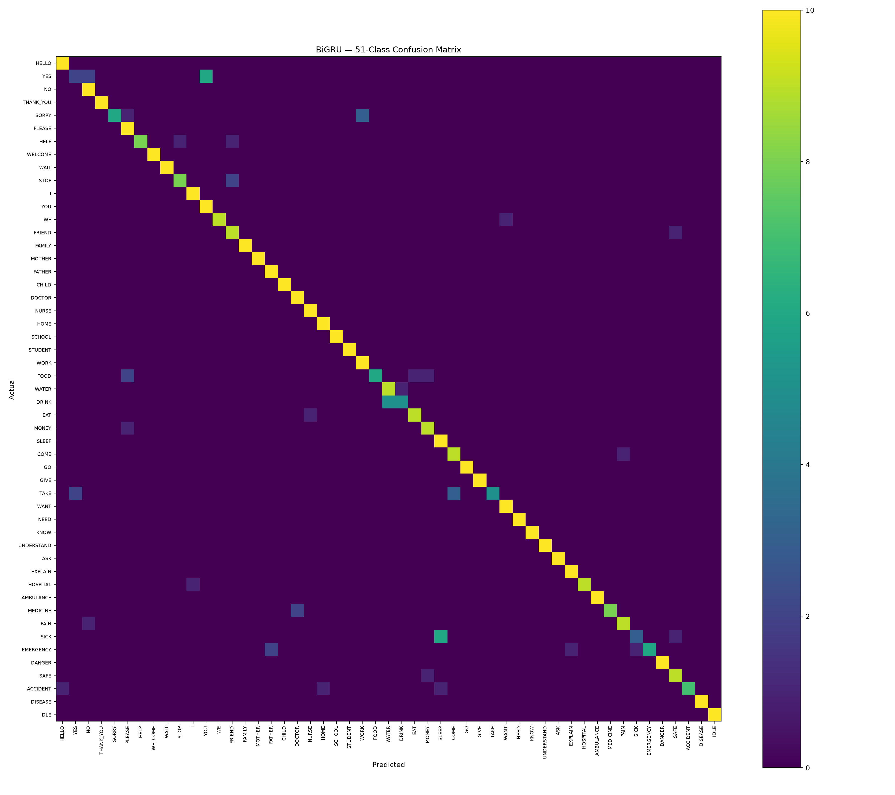

# Context-Aware Communication Assistant for Indian Sign Language (ISL)

A camera-based prototype that recognizes a set of Indian Sign Language signs, builds short sign sequences, and turns recognized text glosses into natural-language output.

## Project flow

```text
Webcam frames (640 x 480)
        ↓
LAB color conversion → CLAHE on the L channel → 3 x 3 Gaussian blur
        ↓
MediaPipe Hands + Face Mesh
        ↓
138 features per frame (126 hand + 12 compact face features)
        ↓
Training-set normalization → 30-frame BiGRU → one of 51 labels
        ↓
Confidence and stability filtering → sign gloss sequence
        ↓
Qwen2.5-3B-Instruct interprets the text glosses
```

The language model receives recognized sign text, not camera images. Common sequences also have deterministic handling in the semantic module. Persistent conversation memory, a true vision-language model, speech output, and Jetson deployment are future work; they are not claimed as completed features.

## Dataset and evaluation

The project uses the custom `V4_ISL_50SIGNS` dataset: 50 sign classes plus `IDLE`, with 30-frame sequences. The recorded split uses sessions 01 and 02 for training (1,020 sequences) and session 03 for testing (510 sequences).

The raw camera frames and derived hand/face feature sequences are not included in this public repository. They contain recorded participant data and make up several gigabytes. The dataset collection, validation, split, and preparation scripts are included so the workflow can be reproduced with data you have permission to use.

The saved BiGRU evaluation report records **89.22% sequence accuracy** and **88.45% macro F1** on the 510-sequence test split. The training script selects the best checkpoint using accuracy on this same split, so these are development results rather than an independent final holdout measurement. Performance on unseen signers or footage has not been established.



## Repository contents

- `scripts/` — dataset capture and validation, sequence preparation, model training, evaluation, sign-sequence building, and live inference.
- `models/bigru_51class_best.pt` and `models/bigru_normalization.npz` — the compact final BiGRU checkpoint and its normalization values.
- `results/` — evaluation reports, confusion matrices, and training histories. Per-frame live feature captures are excluded.

The very large Random Forest pickle and generated sequence archives are also excluded. The Qwen model is downloaded by Transformers the first time the semantic module runs.

## Setup

The project was developed with Python 3.11, OpenCV 4.11.0, MediaPipe 0.10.21, NumPy 1.26.4, and PyTorch 2.8.0 with CUDA.

Create a virtual environment and install the listed packages:

```powershell
py -3.11 -m venv .venv
.\.venv\Scripts\Activate.ps1
python -m pip install --upgrade pip
pip install -r requirements.txt
```

Install a PyTorch 2.8.0 build that matches your operating system and CPU/GPU setup. A CUDA-enabled installation is needed to use an NVIDIA GPU. The Qwen language model is several gigabytes and is downloaded separately on first use.

## Run live recognition

From the repository root, run:

```powershell
python scripts/live_bigru_qwen_semantic_integrated.py
```

The script uses webcam index `1` by default. If your camera uses another index, change `CAMERA_INDEX` near the top of that script. Run it from the repository root so the relative paths to the BiGRU checkpoint and normalization file resolve correctly.

## Rebuild the training data and model

The data itself is not included. After collecting a compatible dataset with the required participant permissions, run these commands from the repository root:

```powershell
python scripts/collect_v4.py
python scripts/validate_dataset.py
python scripts/create_sequence_split.py
python scripts/prepare_sequences.py
python scripts/train_bigru.py
```

The live sequence builder uses a confidence threshold of 0.60, two stable frames, eight idle frames, and a maximum sequence length of 20 glosses. The BiGRU classifies 30-frame windows; those are separate settings.

## Main model configuration

| Setting | Value |
|---|---:|
| Classes | 51 (50 signs + `IDLE`) |
| Features per frame | 138 |
| Frames per model input | 30 |
| BiGRU hidden size | 128 |
| BiGRU layers | 2, bidirectional |
| Dropout | 0.30 |
| Training batch size | 32 |
| Maximum training epochs | 50 |
| Optimizer | Adam, learning rate 0.001 |

## Project status

Implemented: custom dataset tooling, preprocessing and feature extraction, Random Forest/GRU/BiGRU experiments, session-based splitting, evaluation reports, live sign recognition, sequence construction, and text-based semantic interpretation.

Planned: independent evaluation on unseen signers, persistent conversational context, ambiguity resolution, true vision-language input, text-to-speech, latency benchmarking, model optimization, and deployment on Jetson Orin Nano.
